  

  
  
  
  
  
  
  
  

## Sobre mim

Sou o Paulo. Faço jogos e sites, e gosto de fazer tudo do zero: motor, arte, som e física saindo do código, sem pacote de assets.

- 🎮 Agora: jogos em Unity 6 e um terror 3D que roda num único arquivo HTML
- 🧱 Estudando: POO a fundo em C# e .NET
- 🌎 Curto dados abertos: mapas, satélites e terremotos ao vivo

## Projetos em destaque

| | Projeto | O que é | Jogar / ver |
|---|---|---|---|
| 🔦 | **[Turno da Noite](https://github.com/PauloMatiasxvs/turno-da-noite)** | Terror e sobrevivência 3D em WebGL puro, sem engine e sem nenhum arquivo de imagem ou som. A criatura caça pelo barulho que você faz. | [▶ Jogar no navegador](https://paulomatiasxvs.github.io/turno-da-noite/horror/turno-da-noite.html) |
| 🌀 | **[Os Esquecidos](https://github.com/PauloMatiasxvs/os-esquecidos)** | RPG de ação distópico em Unity 6.6, com o labirinto e todo o conteúdo gerados por código. | [⬇ itch.io](https://paulokfk9.itch.io/os-esquecidos) |
| 🛰️ | **[Mirante](https://github.com/PauloMatiasxvs/mirante)** | O planeta ao vivo só com dados abertos: globo 3D com voos sobre o Brasil, terremotos e satélites em tempo real. | [🌐 Abrir](https://mirante-rho.vercel.app) |
| 🏨 | **[HotelCSharp](https://github.com/PauloMatiasxvs/HotelCSharp)** | Sistema de hotelaria em .NET 10: POO, herança, sobrescrita, camadas e banco no Supabase. | código |
| 💧 | **[STAM](https://github.com/PauloMatiasxvs/estacao-movel-de-agua)** | Estação móvel de tratamento de água: reboque solar de osmose reversa com modelo 3D animado. | [🌐 Abrir](https://paulomatiasxvs.github.io/estacao-movel-de-agua/) |
| 📚 | **[Plantão ENEM](https://github.com/PauloMatiasxvs/plantao-enem)** | Estudo para o ENEM: cronograma, provas reais do INEP com correção, simulados, redação e flashcards. | [🌐 Abrir](https://plantao-enem-site.vercel.app) |
| 📊 | **[Ceará em Dados](https://github.com/PauloMatiasxvs/PROJETO-CEARA-EM-DADOS)** | Chat que responde em português sobre dados públicos do Ceará, com texto e gráfico interativo gerados no navegador. | [🌐 Abrir](https://paulomatiasxvs.github.io/PROJETO-CEARA-EM-DADOS/) |

<b>Mais projetos</b>

- [SistemaGestao](https://github.com/PauloMatiasxvs/SistemaGestao) + [frontend](https://github.com/PauloMatiasxvs/sistema-gestao-frontend): gestão em C# com front em JavaScript
- [dashboard-financeiro](https://github.com/PauloMatiasxvs/dashboard-financeiro-finalizado)
- [PONG3D](https://github.com/PauloMatiasxvs/PONG3D), [100bolhas](https://github.com/PauloMatiasxvs/100bolhas) e [simulador de partículas](https://github.com/PauloMatiasxvs/simulador-de-25-particulas-mundo-real): física e jogos em Python
- [Algoritmo Genético](https://github.com/PauloMatiasxvs/DESAFIO-algoritmo-melhorado): evolução rodando no navegador ([ver](https://desafio-algoritmo-melhorado.vercel.app))
- [rick-and-morty-api](https://github.com/PauloMatiasxvs/rick-and-morty-api): consumo de API REST ([ver](https://rick-and-morty-api-chi-gules.vercel.app))

---

<i>"Se dá pra gerar por código, eu gero."</i>

